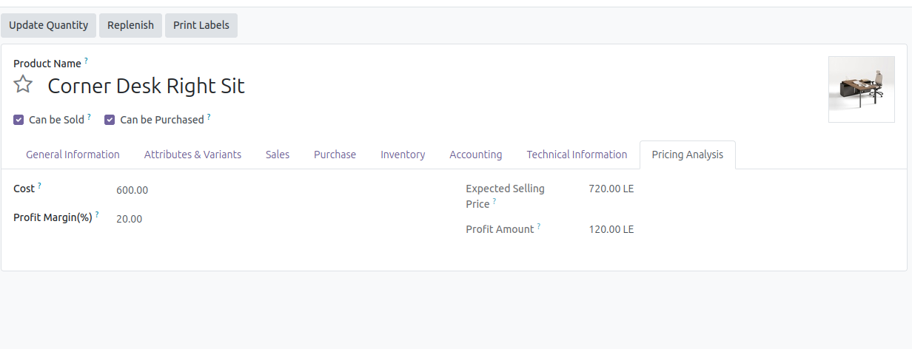
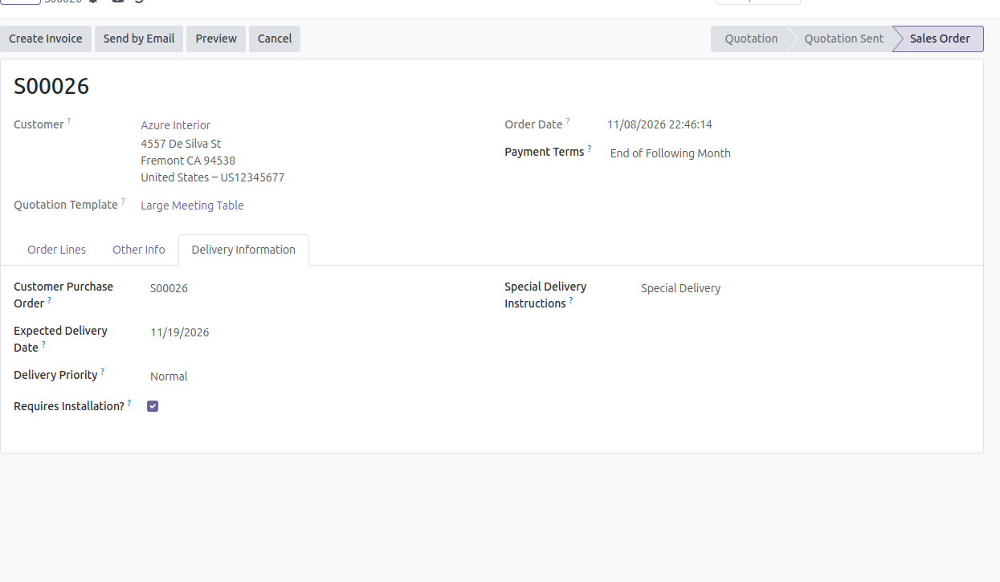

# Niletech Custom Module

A custom Odoo module designed to extend standard business processes with additional product and sales information, validation rules, and better user experience in the form views.

This project is focused on practical business customization and demonstrates how to add task-based enhancements to Odoo without modifying the core application behavior.

## Overview

The module is structured to support multiple business improvements across product and sales workflows.

It currently includes:

- Product technical and warranty information
- Pricing and margin calculation logic
- Delivery planning fields on sales orders

The goal is to provide useful business data directly inside Odoo forms while keeping the implementation clean, maintainable, and easy to expand.

## Project Goals

This module helps improve business operations by:

- collecting richer product information
- automating profit-related calculations
- improving sales-order delivery tracking
- enforcing business validation rules before saving or confirming records
- keeping the custom logic organized by task and responsibility

## Current Scope

### Task 1: Technical Product Information

This task adds technical fields to the Product form to improve product records and maintain data quality.

#### Included Fields

- Brand Name
- Product Origin
- Warranty Period
- Is Under Warranty
- Technical Description

#### Validation Rules

- Warranty period cannot be negative.
- If the product is under warranty, the warranty period must be greater than zero.
- If the product is not under warranty, warranty period must be zero.

#### Purpose

This ensures product information is complete, standardized, and suitable for operations, purchasing, and future reporting.

### Task 2: Pricing Analysis

This task adds logic for margin and pricing analysis on product records.

#### Included Fields

- Profit Margin (%)
- Expected Selling Price
- Profit Amount

#### Calculation Logic

- Expected Selling Price = Standard Price + (Standard Price x Profit Margin / 100)
- Profit Amount = Expected Selling Price - Standard Price

#### Validation Rules

- Profit amount cannot be negative.

#### Purpose

This helps calculate realistic selling prices and monitor the profitability of products.

### Task 3: Delivery Information

This task adds delivery-related details to the Sales Order form to support logistics and order management.

#### Included Fields

- Customer Purchase Order
- Expected Delivery Date
- Delivery Priority
- Requires Installation?
- Special Delivery Instructions

#### Validation Rules

- Expected delivery date cannot be earlier than the order date.
- A sales order cannot be confirmed without an expected delivery date.

#### Purpose

This improves fulfillment planning and ensures that delivery requirements are captured before confirmation.

## Screenshot Gallery

The module is designed to show key business data directly in Odoo forms. Add your screenshots in the `static/description/` folder and reference them below.

Example:

```md



## Module Structure

- `models/product_template_inherit.py`
  - custom field definitions
  - validation logic
  - computed methods
  - business constraints

- `models/sale_order_inherit.py`
  - delivery-related sales order fields
  - validation logic for delivery date and confirmation flow

- `views/product_template_inherit_view.xml`
  - custom tabs and form layout for product information

- `views/sale_order_inherit_view.xml`
  - delivery information tab on the Sales Order form

- `__manifest__.py`
  - module metadata
  - dependencies
  - data files

## How It Works

The module inherits standard Odoo models and adds custom fields directly to existing forms. These fields are then validated using Odoo constraints and displayed in user-friendly tabs or sections.

This approach keeps the base Odoo behavior intact while extending it with project-specific data and rules.

## Installation

1. Copy the module folder into your Odoo custom addons directory.
2. Update the Odoo addons list.
3. Restart the Odoo server.
4. Install the module from the Apps menu.
5. Open a Product or Sales Order record to review the customized sections.

## Usage

After installing the module:

- open a product record to review technical and pricing fields
- set the required product information and validation values
- open a sales order to enter delivery information
- confirm the order only after required delivery data is provided

## Developer Notes

This project demonstrates recommended Odoo customization practices, including:

- model inheritance instead of modifying core data directly
- business rule validation with `@api.constrains`
- computed fields for derived values
- view inheritance for form customization
- modular task-based organization for cleaner maintenance

## Summary

The Niletech Custom Module is a practical example of how to extend Odoo with business-specific fields, validations, and custom views. It is designed to be reusable, readable, and easily expanded for future customizations in inventory, sales, purchasing, accounting, or HR.

This project gives a solid foundation for building maintainable Odoo custom modules that align with real-world business needs.
```
